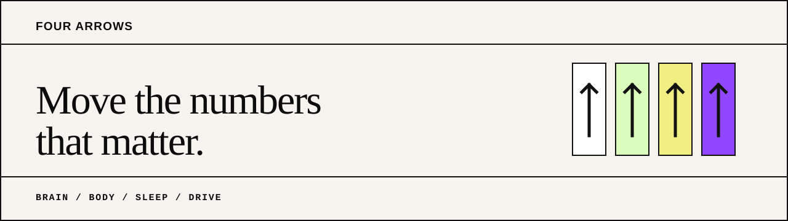

  

  <strong>Measurable men's health across Brain, Body, Sleep, and Drive.</strong>

  <a href="https://fourarrows.ai">Website</a>

## What We Are Building

Four Arrows is building a clearer way to connect how men feel with what their
bodies are doing. The operating loop is simple: define the goal, track the
signal, adjust the plan, and measure again.

| Brain | Body | Sleep | Drive |
|---|---|---|---|
| Cognition, mood, and stress | Strength, composition, and cardio-metabolic markers | Recovery and sleep signals | Hormones and sexual health |

## Current Stage

Four Arrows is pre-launch. The public website and non-PHI private beta waitlist
are live. Product and clinical systems are still in development.

We do not publish member data, clinical records, private source code, or
unreviewed health claims.
